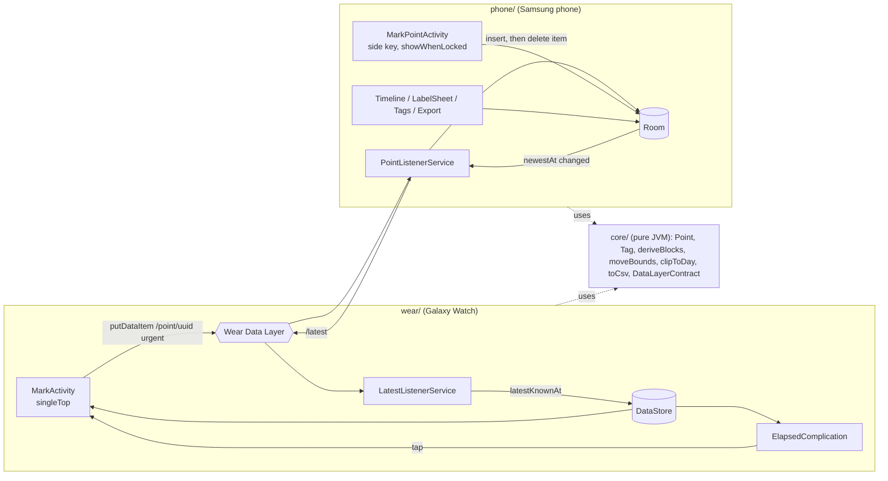

# Time Tracker MVP Implementation Plan

> **For agentic workers:** REQUIRED SUB-SKILL: Use superpowers:subagent-driven-development (recommended) or superpowers:executing-plans to implement this plan task-by-task. Steps use checkbox (`- [ ]`) syntax for tracking.

**Goal:** A Galaxy Watch + Samsung phone app pair where one physical double-press records a timestamp, and the phone lets the owner label, delete, move and insert points between those timestamps, then export CSV.

**Architecture:** Three Gradle modules. `core/` is a pure-JVM Kotlin library holding the domain (points, derived blocks, edit rules, CSV, Data Layer path constants) and all unit tests. `phone/` owns Room (the only database), the timeline/label/tags/export UI, the side-key capture activity and the `WearableListenerService` that consumes `/point/*` DataItems and publishes `/latest`. `wear/` is a launch-write-vibrate-exit activity plus a complication; it stores one preference.

**Tech Stack:** Kotlin 2.0, AGP 8.7, compileSdk 35, Jetpack Compose (BOM 2024.10), Compose for Wear OS 1.4, Room 2.6, DataStore Preferences, play-services-wearable 18.2, Robolectric 4.13 for Room tests, JUnit 4.

**Spec:** `docs/superpowers/specs/2026-10-25-time-tracker-mvp-design.md`



## Global Constraints

- `applicationId` is `dev.timetracker.app` in **both** `phone/` and `wear/`; both modules use the same debug keystore (the default `~/.android/debug.keystore`). Data Layer pairing depends on this.
- `minSdk`: phone 26, wear 33. `compileSdk` and `targetSdk` 35.
- Every press is recorded. No debounce, no auto-merge, anywhere.
- No labeling, lists or settings on the watch. The watch persists exactly one value: `latestKnownAt: Long`.
- Points sort by `(at, createdAt, id)`. Zero-length blocks are legal and shown as `0s`.
- Label and note belong to a block's **start point**. Delete keeps the earlier point's label. Inserted points (manual or late-arriving) never copy a label.
- Move bounds are non-strict: `prev.at <= at <= next.at`; for the last point the upper bound is `now`.
- UI strings are English, in `strings.xml`, single default locale.
- No DI framework, no navigation library, no network, no Play Store work. Distribution is `adb install`.
- Data Layer paths: `/point/<uuid>` with keys `id`, `at`, `source`; `/latest` with key `at`.
- Phone listener deletes a `/point/*` item only after a successful Room insert.

## Review Focus

1. A watch point that arrives after the owner has already labeled the block it lands in: the earlier half must keep its label, the new half is unlabeled, nothing is lost. (Task 2 test `late_point_splits_block_without_copying_label`.)
2. A block spanning local midnight: it must show on both days, clipped, with its label, and the CSV row must carry the real start and end. (Task 3 tests `block_spanning_midnight_appears_clipped_on_both_days`, `csv_uses_real_start_and_end_for_midnight_block`.)
3. Moving the current block's start point forward past `now`, or any point past its neighbour: must be rejected by bounds, not silently reordered. (Task 3 test `move_bounds_for_last_point_end_at_now`.)
4. The same `/point/<uuid>` delivered twice (Data Layer redelivery after a crash between insert and delete): exactly one row. (Task 4 test `insert_same_id_twice_keeps_one_row`.)
5. Phone capture from a locked phone in a pocket: the activity must appear over the keyguard and finish by itself; a second double-press while the overlay is still visible must record a second point. (Task 6 manual steps; unit test `mark_on_new_intent_records_second_point` on the pure decision function.)

---

### Task 0: Android toolchain

**Files:**
- Create: `~/.zshrc` additions (ANDROID_HOME, PATH) — user-level, not committed
- Create: `.gitignore` (append), `local.properties` (generated, ignored)

**Interfaces:**
- Produces: a working `sdkmanager`, `adb`, `ANDROID_HOME=$HOME/Library/Android/sdk`.

- [ ] **Step 1: Install command-line tools and SDK packages**

```bash
brew install --cask android-commandlinetools
export ANDROID_HOME="$HOME/Library/Android/sdk"
mkdir -p "$ANDROID_HOME"
yes | sdkmanager --sdk_root="$ANDROID_HOME" --licenses
sdkmanager --sdk_root="$ANDROID_HOME" "platform-tools" "platforms;android-35" "build-tools;35.0.0"
```

- [ ] **Step 2: Persist the environment**

Append to `~/.zshrc`:

```bash
export ANDROID_HOME="$HOME/Library/Android/sdk"
export PATH="$ANDROID_HOME/platform-tools:$PATH"
```

- [ ] **Step 3: Verify**

Run: `source ~/.zshrc && adb version && ls "$ANDROID_HOME/platforms"`
Expected: `Android Debug Bridge version ...` and `android-35`.

- [ ] **Step 4: Ignore generated files**

Append to `.gitignore`: `local.properties`, `.gradle/`, `build/`, `*/build/`, `.idea/`, `*.iml`, `.kotlin/`. Commit:

```bash
git add .gitignore
git commit -m "chore: ignore Android build outputs"
```

---

### Task 1: Gradle skeleton with three modules

**Files:**
- Create: `settings.gradle.kts`, `build.gradle.kts`, `gradle.properties`, `gradle/libs.versions.toml`, `gradlew` (via `gradle wrapper` or copy from any AGP 8.7 template with Gradle 8.9)
- Create: `core/build.gradle.kts`, `core/src/main/kotlin/dev/timetracker/core/Placeholder.kt`, `core/src/test/kotlin/dev/timetracker/core/PlaceholderTest.kt`
- Create: `phone/build.gradle.kts`, `phone/src/main/AndroidManifest.xml`, `phone/src/main/res/values/strings.xml` (`app_name` = `Time Tracker`)
- Create: `wear/build.gradle.kts`, `wear/src/main/AndroidManifest.xml` (with `<uses-feature android:name="android.hardware.type.watch" />` and `com.google.android.wearable.standalone` meta-data `false`), `wear/src/main/res/values/strings.xml`

**Interfaces:**
- Produces: module names `:core` (`kotlin("jvm")`), `:phone`, `:wear` (both `com.android.application`, namespace `dev.timetracker.phone` / `dev.timetracker.wear`, `applicationId = "dev.timetracker.app"`). `:phone` and `:wear` depend on `project(":core")`.
- Version catalog aliases used by later tasks: `libs.room.runtime`, `libs.room.ktx`, `libs.room.compiler` (ksp), `libs.datastore.preferences`, `libs.play.services.wearable`, `libs.compose.bom`, `libs.wear.compose.material`, `libs.wear.compose.foundation`, `libs.wear.watchface.complications.data.source.ktx`, `libs.robolectric`, `libs.junit`, `libs.androidx.test.core`.

- [ ] **Step 1: Write the placeholder test**

```kotlin
class PlaceholderTest {
    @Test fun `build works`() = assertEquals(2, 1 + 1)
}
```

- [ ] **Step 2: Create the Gradle files**

Kotlin 2.0.21 with the `org.jetbrains.kotlin.plugin.compose` plugin on `:phone` and `:wear`, KSP 2.0.21-1.0.27, JVM target 17. If any version fails to resolve, bump to the newest stable and note it in the commit message.

- [ ] **Step 3: Verify**

Run: `./gradlew :core:test :phone:assembleDebug :wear:assembleDebug`
Expected: `BUILD SUCCESSFUL`, APKs at `phone/build/outputs/apk/debug/` and `wear/build/outputs/apk/debug/`.

- [ ] **Step 4: Commit**

```bash
git add settings.gradle.kts build.gradle.kts gradle.properties gradle gradlew gradlew.bat core phone wear
git commit -m "chore: gradle skeleton with core, phone and wear modules"
```

---

### Task 2: Domain model and block derivation (core)

**Files:**
- Create: `core/src/main/kotlin/dev/timetracker/core/Model.kt`
- Create: `core/src/main/kotlin/dev/timetracker/core/Blocks.kt`
- Create: `core/src/main/kotlin/dev/timetracker/core/DataLayerContract.kt`
- Test: `core/src/test/kotlin/dev/timetracker/core/BlocksTest.kt`
- Delete: the Task 1 placeholders.

**Interfaces:**
- Produces:

```kotlin
enum class Source { WATCH, PHONE, MANUAL }
data class Point(val id: String, val at: Long, val source: Source,
                 val tagId: String? = null, val note: String? = null, val createdAt: Long)
data class Tag(val id: String, val name: String, val color: Int, val lastUsedAt: Long)
data class Block(val start: Point, val end: Point?, val endAt: Long) {
    val durationMs: Long get() = endAt - start.at
    val isCurrent: Boolean get() = end == null
}
val pointOrder: Comparator<Point>                       // (at, createdAt, id)
fun deriveBlocks(points: List<Point>, now: Long): List<Block>
object DataLayerContract {
    const val POINT_PATH_PREFIX = "/point/"; const val LATEST_PATH = "/latest"
    const val KEY_ID = "id"; const val KEY_AT = "at"; const val KEY_SOURCE = "source"
    fun pointPath(id: String) = POINT_PATH_PREFIX + id
}
```

- [ ] **Step 1: Write the failing tests**

```kotlin
class BlocksTest {
    private fun p(id: String, at: Long, tag: String? = null, created: Long = at) =
        Point(id, at, Source.WATCH, tag, null, created)

    @Test fun `no points gives no blocks`() = assertEquals(emptyList<Block>(), deriveBlocks(emptyList(), 1000))
    @Test fun `one point gives one current block ending now`() {
        val b = deriveBlocks(listOf(p("a", 100)), 1000)
        assertEquals(1, b.size); assertTrue(b[0].isCurrent); assertEquals(900, b[0].durationMs)
    }
    @Test fun `blocks follow sorted order regardless of input order`() {
        val b = deriveBlocks(listOf(p("b", 200), p("a", 100)), 1000)
        assertEquals(listOf("a", "b"), b.map { it.start.id }); assertEquals(100, b[0].durationMs)
    }
    @Test fun `equal at gives zero length block ordered by createdAt then id`() {
        val b = deriveBlocks(listOf(p("y", 100, created = 5), p("x", 100, created = 5), p("z", 100, created = 1)), 1000)
        assertEquals(listOf("z", "x", "y"), b.map { it.start.id }); assertEquals(0, b[0].durationMs)
    }
    @Test fun `block label is its start point label`() {
        val b = deriveBlocks(listOf(p("a", 100, tag = "work"), p("b", 200)), 1000)
        assertEquals("work", b[0].start.tagId); assertNull(b[1].start.tagId)
    }
    @Test fun `late_point_splits_block_without_copying_label`() {
        val before = deriveBlocks(listOf(p("a", 100, tag = "work"), p("c", 300)), 1000)
        val after = deriveBlocks(listOf(p("a", 100, tag = "work"), p("c", 300), p("b", 200)), 1000)
        assertEquals("work", after[0].start.tagId); assertNull(after[1].start.tagId)
        assertEquals(before[0].start, after[0].start); assertEquals(100, after[0].durationMs)
    }
}
```

- [ ] **Step 2: Run to verify failure**

Run: `./gradlew :core:test`
Expected: compilation failure, `Point` unresolved.

- [ ] **Step 3: Implement `Model.kt`, `Blocks.kt`, `DataLayerContract.kt`** with the signatures above. `deriveBlocks` sorts with `pointOrder` and zips each point with its successor; the last point gets `end = null, endAt = now`.

- [ ] **Step 4: Run to verify pass**

Run: `./gradlew :core:test`
Expected: `BUILD SUCCESSFUL`, 6 tests passed.

- [ ] **Step 5: Commit**

```bash
git add core
git commit -m "feat(core): point model, block derivation, data layer contract"
```

---

### Task 3: Edit rules, day clipping and CSV (core)

**Files:**
- Create: `core/src/main/kotlin/dev/timetracker/core/Edits.kt`
- Create: `core/src/main/kotlin/dev/timetracker/core/Days.kt`
- Create: `core/src/main/kotlin/dev/timetracker/core/Csv.kt`
- Test: `core/src/test/kotlin/dev/timetracker/core/EditsTest.kt`, `DaysTest.kt`, `CsvTest.kt`

**Interfaces:**
- Consumes: Task 2 types.
- Produces:

```kotlin
fun moveBounds(points: List<Point>, pointId: String, now: Long): LongRange   // prev.at..next.at, last → ..now, first → Long.MIN_VALUE..
fun midpoint(block: Block): Long
fun clipToDay(blocks: List<Block>, dayStart: Long, dayEnd: Long): List<Block>  // keeps blocks overlapping [dayStart, dayEnd); clips start.at/endAt via copy — see note
fun toCsv(blocks: List<Block>, tags: Map<String, Tag>, zone: ZoneId): String
```

Note for `clipToDay`: return a `ClippedBlock(block: Block, visibleStart: Long, visibleEnd: Long)` rather than mutating `Point`; the UI renders `visibleStart..visibleEnd` and the label from `block.start`.

CSV header is exactly `start_iso,end_iso,duration_sec,tag,note,source`; timestamps are `DateTimeFormatter.ISO_OFFSET_DATE_TIME` in `zone`; the current block has empty `end_iso` and `duration_sec` computed to `endAt`; fields containing `,`, `"` or newline are double-quoted with `"` doubled.

- [ ] **Step 1: Write the failing tests**

```kotlin
class EditsTest {
    // points a@100, b@200, c@300, now=1000
    @Test fun `middle point bounded by neighbours inclusive`() = assertEquals(100L..300L, moveBounds(pts, "b", 1000))
    @Test fun `first point has no lower bound`() = assertEquals(Long.MIN_VALUE, moveBounds(pts, "a", 1000).first)
    @Test fun `move_bounds_for_last_point_end_at_now`() = assertEquals(200L..1000L, moveBounds(pts, "c", 1000))
    @Test fun `midpoint of block`() = assertEquals(150L, midpoint(Block(pts[0], pts[1], 200)))
}
class DaysTest {
    @Test fun `block_spanning_midnight_appears_clipped_on_both_days`() {
        // block 23:00 day1 → 01:00 day2 (ms epoch), label "sleep"
        val d1 = clipToDay(listOf(block), day1Start, day2Start); val d2 = clipToDay(listOf(block), day2Start, day3Start)
        assertEquals(day2Start, d1.single().visibleEnd); assertEquals(day2Start, d2.single().visibleStart)
        assertEquals("sleep", d2.single().block.start.tagId)
    }
    @Test fun `block outside day is excluded`() = assertTrue(clipToDay(listOf(block), day3Start, day4Start).isEmpty())
}
class CsvTest {
    @Test fun `header and one row`() {
        val csv = toCsv(listOf(Block(p("a", t("07:10")), p("b", t("07:45")), t("07:45"))), mapOf("tg" to breakfast), ZoneId.of("Asia/Singapore"))
        assertEquals("start_iso,end_iso,duration_sec,tag,note,source\n2026-10-25T07:10:00+08:00,2026-10-25T07:45:00+08:00,2100,Breakfast,,WATCH\n", csv)
    }
    @Test fun `current block has empty end`() { /* end_iso empty, duration to endAt */ }
    @Test fun `note with comma is quoted`() { /* "a, b" → "\"a, b\"" */ }
    @Test fun `csv_uses_real_start_and_end_for_midnight_block`() { /* unclipped start/end in output */ }
}
```

- [ ] **Step 2: Run to verify failure** — `./gradlew :core:test`, expected unresolved references.

- [ ] **Step 3: Implement `Edits.kt`, `Days.kt`, `Csv.kt`** per the Interfaces block.

- [ ] **Step 4: Run to verify pass** — `./gradlew :core:test`, all green.

- [ ] **Step 5: Commit**

```bash
git add core
git commit -m "feat(core): move bounds, day clipping, csv export"
```

---

### Task 4: Room database and repository (phone)

**Files:**
- Create: `phone/src/main/kotlin/dev/timetracker/phone/data/Entities.kt` (`PointEntity`, `TagEntity`, mappers to/from core `Point`/`Tag`)
- Create: `phone/src/main/kotlin/dev/timetracker/phone/data/Dao.kt`
- Create: `phone/src/main/kotlin/dev/timetracker/phone/data/AppDatabase.kt` (`Room.databaseBuilder`, name `timetracker.db`, singleton `AppDatabase.get(context)`)
- Create: `phone/src/main/kotlin/dev/timetracker/phone/data/PointRepository.kt`
- Test: `phone/src/test/kotlin/dev/timetracker/phone/data/PointDaoTest.kt` (Robolectric, in-memory DB)

**Interfaces:**
- Consumes: core `Point`, `Tag`, `Source`.
- Produces:

```kotlin
@Dao interface PointDao {
    @Insert(onConflict = OnConflictStrategy.IGNORE) suspend fun insertIgnore(p: PointEntity): Long   // -1 when ignored
    @Query("DELETE FROM points WHERE id = :id") suspend fun delete(id: String)
    @Query("UPDATE points SET at = :at WHERE id = :id") suspend fun updateAt(id: String, at: Long)
    @Query("UPDATE points SET tagId = :tagId WHERE id = :id") suspend fun updateTag(id: String, tagId: String?)
    @Query("UPDATE points SET note = :note WHERE id = :id") suspend fun updateNote(id: String, note: String?)
    @Query("SELECT * FROM points") fun observeAll(): Flow<List<PointEntity>>
    @Query("SELECT MAX(at) FROM points") suspend fun newestAt(): Long?
    @Query("UPDATE points SET tagId = NULL WHERE tagId = :tagId") suspend fun clearTag(tagId: String): Int
    @Query("SELECT COUNT(*) FROM points WHERE tagId = :tagId") suspend fun countWithTag(tagId: String): Int
}
@Dao interface TagDao {
    @Query("SELECT * FROM tags ORDER BY lastUsedAt DESC") fun observeAll(): Flow<List<TagEntity>>
    @Insert suspend fun insert(t: TagEntity)
    @Query("UPDATE tags SET name = :name WHERE id = :id") suspend fun rename(id: String, name: String)
    @Query("UPDATE tags SET lastUsedAt = :at WHERE id = :id") suspend fun touch(id: String, at: Long)
    @Query("DELETE FROM tags WHERE id = :id") suspend fun delete(id: String)
    @Query("SELECT COUNT(*) FROM tags WHERE LOWER(name) = LOWER(:name)") suspend fun countByName(name: String): Int
}
class PointRepository(private val db: AppDatabase, val clock: () -> Long = System::currentTimeMillis) {
    val points: Flow<List<Point>>; val tags: Flow<List<Tag>>
    suspend fun mark(source: Source, at: Long = clock(), id: String = UUID.randomUUID().toString()): Boolean  // false if id existed
    suspend fun deletePoint(id: String); suspend fun movePoint(id: String, at: Long)
    suspend fun insertManual(at: Long): Point
    suspend fun setTag(pointId: String, tagId: String?); suspend fun setNote(pointId: String, note: String?)
    suspend fun createTag(name: String): Tag?          // null if name taken (case-insensitive); color from TagPalette
    suspend fun renameTag(id: String, name: String): Boolean; suspend fun deleteTag(id: String): Int   // returns cleared point count
    suspend fun newestAt(): Long?
}
object TagPalette { val colors: List<Int> /* 8 ARGB ints */; fun next(existing: Int): Int = colors[existing % colors.size] }
```

`setTag` also calls `TagDao.touch(tagId, clock())`. The repository is the only writer to Room; Tasks 5–9 use it, never the DAOs.

- [ ] **Step 1: Write the failing Robolectric tests**

```kotlin
@RunWith(RobolectricTestRunner::class)
class PointDaoTest {
    // in-memory AppDatabase, repo = PointRepository(db) { 1000L }
    @Test fun `insert_same_id_twice_keeps_one_row`() = runTest {
        assertTrue(repo.mark(Source.WATCH, at = 100, id = "x")); assertFalse(repo.mark(Source.WATCH, at = 100, id = "x"))
        assertEquals(1, repo.points.first().size)
    }
    @Test fun `createTag rejects case-insensitive duplicate`() = runTest {
        assertNotNull(repo.createTag("Work")); assertNull(repo.createTag("work"))
    }
    @Test fun `deleteTag clears points and returns count`() = runTest { /* 2 points tagged → returns 2, both tagId null */ }
    @Test fun `setTag touches lastUsedAt`() = runTest { /* tags flow order changes */ }
}
```

- [ ] **Step 2: Run to verify failure** — `./gradlew :phone:testDebugUnitTest`, expected unresolved references.

- [ ] **Step 3: Implement entities, DAOs, database, repository, palette** per the Interfaces block. Add to `phone/build.gradle.kts`: `testOptions.unitTests.isIncludeAndroidResources = true`, Robolectric and Room KSP dependencies.

- [ ] **Step 4: Run to verify pass** — `./gradlew :phone:testDebugUnitTest`, all green.

- [ ] **Step 5: Commit**

```bash
git add phone
git commit -m "feat(phone): room database and point repository"
```

---

### Task 5: Latest-point publisher and sync receiver (phone)

**Files:**
- Create: `phone/src/main/kotlin/dev/timetracker/phone/sync/LatestPublisher.kt`
- Create: `phone/src/main/kotlin/dev/timetracker/phone/sync/PointItemParser.kt`
- Create: `phone/src/main/kotlin/dev/timetracker/phone/sync/PointListenerService.kt`
- Modify: `phone/src/main/AndroidManifest.xml` (service with `com.google.android.gms.wearable.DATA_CHANGED` intent filter, `data scheme="wear" host="*" pathPrefix="/point/"`)
- Test: `phone/src/test/kotlin/dev/timetracker/phone/sync/PointItemParserTest.kt`

**Interfaces:**
- Consumes: `PointRepository.mark`, `PointRepository.newestAt`, `DataLayerContract`.
- Produces:

```kotlin
data class IncomingPoint(val id: String, val at: Long, val source: Source)
object PointItemParser { fun parse(path: String, data: Map<String, Any?>): IncomingPoint? }  // null when path/keys invalid
class LatestPublisher(private val dataClient: DataClient) { suspend fun publish(newestAt: Long?) }  // putDataItem(/latest, {at}) ; no-op when null
suspend fun PointRepository.markAndPublish(source: Source, publisher: LatestPublisher, at: Long = clock(), id: String = UUID.randomUUID().toString()): Boolean
```

`PointListenerService.onDataChanged`: for each `TYPE_CHANGED` event whose path starts with `/point/`, parse via `DataMapItem.fromDataItem(...).dataMap` → `repo.mark(source, at, id)` inside `runBlocking`; on success (or on duplicate, which is also a success) call `dataClient.deleteDataItems(uri)`, then `publisher.publish(repo.newestAt())`. On exception, leave the item in place.

- [ ] **Step 1: Write the failing parser tests**

```kotlin
class PointItemParserTest {
    @Test fun `parses valid point`() = assertEquals(IncomingPoint("u1", 123L, Source.WATCH),
        PointItemParser.parse("/point/u1", mapOf("id" to "u1", "at" to 123L, "source" to "WATCH")))
    @Test fun `rejects other path`() = assertNull(PointItemParser.parse("/latest", mapOf("at" to 1L)))
    @Test fun `rejects missing at`() = assertNull(PointItemParser.parse("/point/u1", mapOf("id" to "u1", "source" to "WATCH")))
}
```

- [ ] **Step 2: Run to verify failure** — `./gradlew :phone:testDebugUnitTest`.

- [ ] **Step 3: Implement parser, publisher, service, manifest entry.**

- [ ] **Step 4: Run to verify pass** — `./gradlew :phone:testDebugUnitTest :phone:assembleDebug`.

- [ ] **Step 5: Commit**

```bash
git add phone
git commit -m "feat(phone): data layer listener consumes /point items and publishes /latest"
```

---

### Task 6: Phone capture activity and side-key alias

**Files:**
- Create: `phone/src/main/kotlin/dev/timetracker/phone/capture/LaunchDecision.kt`
- Create: `phone/src/main/kotlin/dev/timetracker/phone/capture/MarkPointActivity.kt`
- Create: `phone/src/main/kotlin/dev/timetracker/phone/capture/ConfirmOverlay.kt` (Compose: time `HH:mm`, `● Recorded`, `Previous block 47 min`)
- Create: `phone/src/main/kotlin/dev/timetracker/phone/ui/Format.kt` (`formatDuration(ms): String` → `0s`, `12s`, `35m`, `3h 10m`; `formatTime(epochMs, zone): String`)
- Modify: `phone/src/main/AndroidManifest.xml`: `MarkPointActivity` with `android:launchMode="singleTop"`, `android:showWhenLocked="true"`, `android:turnScreenOn="true"`, `android:excludeFromRecents="true"`, theme translucent; plus `<activity-alias android:name=".Mark" android:targetActivity=".capture.MarkPointActivity" android:label="@string/mark_alias_label" android:exported="true">` with LAUNCHER intent filter. `strings.xml`: `mark_alias_label` = `Mark`, `recorded` = `Recorded`, `previous_block` = `Previous block %1$s`.
- Test: `phone/src/test/kotlin/dev/timetracker/phone/capture/LaunchDecisionTest.kt`, `phone/src/test/kotlin/dev/timetracker/phone/ui/FormatTest.kt`

**Interfaces:**
- Consumes: `PointRepository.markAndPublish`, `LatestPublisher`.
- Produces:

```kotlin
object LaunchDecision { fun shouldRecord(savedInstanceStateIsNull: Boolean, fromNewIntent: Boolean): Boolean }
fun formatDuration(ms: Long): String
fun formatTime(epochMs: Long, zone: ZoneId): String   // "14:32"
```

Activity flow: `onCreate` → if `shouldRecord(savedInstanceState == null, false)` call `record()`; `onNewIntent` → `record()`. `record()` = `markAndPublish(Source.PHONE)` on `lifecycleScope`, vibrate 50 ms via `VibratorManager`, set overlay state (time, previous-block duration from `repo.newestAt()` taken *before* the insert), `finishAndRemoveTask()` after 2000 ms.

- [ ] **Step 1: Write the failing tests**

```kotlin
class LaunchDecisionTest {
    @Test fun `fresh create records`() = assertTrue(LaunchDecision.shouldRecord(true, false))
    @Test fun `recreated activity does not record`() = assertFalse(LaunchDecision.shouldRecord(false, false))
    @Test fun `mark_on_new_intent_records_second_point`() = assertTrue(LaunchDecision.shouldRecord(false, true))
}
class FormatTest {
    @Test fun `durations`() { assertEquals("0s", formatDuration(0)); assertEquals("12s", formatDuration(12_000))
        assertEquals("35m", formatDuration(35 * 60_000L)); assertEquals("3h 10m", formatDuration(190 * 60_000L)) }
}
```

- [ ] **Step 2: Run to verify failure** — `./gradlew :phone:testDebugUnitTest`.

- [ ] **Step 3: Implement decision, format helpers, overlay, activity, manifest.**

- [ ] **Step 4: Run tests and build** — `./gradlew :phone:testDebugUnitTest :phone:assembleDebug`.

- [ ] **Step 5: Device spike (§6.2 of spec) — manual**

`adb install -r phone/build/outputs/apk/debug/phone-debug.apk`. On the phone: Settings → Advanced features → Side button → Double press → Open app. Record the outcome in `docs/superpowers/plans/2026-10-25-time-tracker-mvp.md` under this step:
- If the picker lists **Mark** separately: bind it. Alias path confirmed.
- If it lists only **Time Tracker**: bind it; Task 8's timeline button is the capture path, and the alias stays as a home-screen shortcut.
Then lock the phone, double-press: overlay appears over the lock screen, vibrates, disappears by itself. Double-press twice within 2 s: two rows later in the timeline (verify after Task 8).

- [ ] **Step 6: Commit**

```bash
git add phone docs/superpowers/plans/2026-10-25-time-tracker-mvp.md
git commit -m "feat(phone): side-key capture activity with lock-screen overlay"
```

---

### Task 7: Watch app — mark, confirm, latest listener

**Files:**
- Create: `wear/src/main/kotlin/dev/timetracker/wear/LatestStore.kt` (DataStore Preferences, key `latest_known_at: Long`; `suspend fun get(): Long?`, `suspend fun setIfNewer(at: Long)`)
- Create: `wear/src/main/kotlin/dev/timetracker/wear/PointSender.kt` (`suspend fun send(dataClient, at: Long, id: String)` → `PutDataMapRequest.create(pointPath(id))` with `KEY_ID`, `KEY_AT`, `KEY_SOURCE="WATCH"`, `.setUrgent()`)
- Create: `wear/src/main/kotlin/dev/timetracker/wear/MarkActivity.kt` (singleTop; reuses `LaunchDecision` — move `LaunchDecision.kt` and `Format.kt` from `:phone` to `:core` in this task, since both apps need them; adjust Task 6 imports)
- Create: `wear/src/main/kotlin/dev/timetracker/wear/ConfirmScreen.kt` (Wear Compose: three lines per spec; third line omitted when no previous point)
- Create: `wear/src/main/kotlin/dev/timetracker/wear/LatestListenerService.kt` (`WearableListenerService` for `/latest` → `LatestStore.setIfNewer`)
- Modify: `wear/src/main/AndroidManifest.xml` (activity `singleTop`, LAUNCHER; service with DATA_CHANGED filter, `pathPrefix="/latest"`; `uses-permission VIBRATE`)
- Test: `core/src/test/kotlin/dev/timetracker/core/LaunchDecisionTest.kt`, `FormatTest.kt` (moved)

**Interfaces:**
- Consumes: `DataLayerContract`, `LaunchDecision`, `formatDuration`, `formatTime`.
- Produces: `MarkActivity` as the only watch entry point (`dev.timetracker.wear.MarkActivity`).

Activity flow: `record()` = `now = System.currentTimeMillis()`; `prev = LatestStore.get()`; `PointSender.send(...)`; `LatestStore.setIfNewer(now)`; vibrate 50 ms; show `ConfirmScreen(now, prev)`; `finishAndRemoveTask()` after 3000 ms. The DataItem is written before anything else so a kill mid-animation loses nothing.

- [ ] **Step 1: Move `LaunchDecision` and `Format` to `:core`** with their tests; run `./gradlew :core:test :phone:testDebugUnitTest` — green.

- [ ] **Step 2: Implement store, sender, activity, screen, listener, manifest.**

- [ ] **Step 3: Build** — `./gradlew :wear:assembleDebug` — `BUILD SUCCESSFUL`.

- [ ] **Step 4: Device check — manual**

Enable Wi-Fi ADB on the watch (Settings → Developer options → ADB debugging + Debug over Wi-Fi), `adb connect <watch-ip>:5555`, `adb -s <watch> install -r wear/build/outputs/apk/debug/wear-debug.apk`. Watch: Settings → Advanced features → Customize keys → Home key double press → Time Tracker. Double-press: vibration, confirm screen, auto-exit. On the phone: `adb -s <phone> shell "run-as dev.timetracker.app sqlite3 databases/timetracker.db 'select count(*) from points'"` increases within ~5 s (or wait for Task 8's timeline). Airplane mode on watch → double-press twice → airplane off → both arrive, no duplicates.

- [ ] **Step 5: Commit**

```bash
git add core phone wear
git commit -m "feat(wear): mark activity sends /point and shows confirmation"
```

---

### Task 8: Timeline screen (phone)

**Files:**
- Create: `phone/src/main/kotlin/dev/timetracker/phone/ui/TimelineViewModel.kt`
- Create: `phone/src/main/kotlin/dev/timetracker/phone/ui/TimelineScreen.kt`
- Create: `phone/src/main/kotlin/dev/timetracker/phone/MainActivity.kt` (LAUNCHER, label `Time Tracker`; hosts `TimelineScreen` and, from Task 9/10, the sheet and settings)
- Create: `phone/src/main/kotlin/dev/timetracker/phone/ui/Theme.kt`
- Modify: `strings.xml`: `today` = `Today`, `unlabeled` = `Unlabeled`, `in_progress` = `In progress · %1$s`, `mark` = `● Mark`, `empty_hint` = `Press Mark, or bind the side button's double press to “Mark”.`, `deleted_point` = `Point deleted`, `undo` = `Undo`.
- Test: `phone/src/test/kotlin/dev/timetracker/phone/ui/TimelineViewModelTest.kt`

**Interfaces:**
- Consumes: `PointRepository`, `LatestPublisher`, `deriveBlocks`, `clipToDay`, `formatDuration`, `formatTime`.
- Produces:

```kotlin
data class TimelineRow(val block: ClippedBlock, val tag: Tag?)
data class TimelineState(val day: LocalDate, val rows: List<TimelineRow>, val isEmpty: Boolean)
class TimelineViewModel(repo: PointRepository, publisher: LatestPublisher, zone: ZoneId, clock: () -> Long) : ViewModel() {
    val state: StateFlow<TimelineState>
    fun previousDay(); fun nextDay(); fun today()
    fun mark()                                   // Source.PHONE via markAndPublish
    fun deletePoint(id: String): Point           // returns the removed point for undo; publishes /latest if newest changed
    fun undoDelete(p: Point)                     // re-inserts with same id/at/tag/note; publishes likewise
}
```

UI: header `Today · Oct 25` (or `Sat, Oct 25` for other days) with `‹ ›`; `LazyColumn` of rows (start time, tag chip or dashed `Unlabeled`, duration; current block ticks every second via a `flow { while(true) { emit(now); delay(1000) } }` combined into state); long-press row → `deletePoint` + `SnackbarHost` with `Undo` for 5 s; bottom `Button` `● Mark` full width. Tap row → Task 9's sheet (wire a `onRowClick: (Block) -> Unit` now).

- [ ] **Step 1: Write the failing ViewModel tests** (Robolectric not needed — use a fake `PointRepository` over an in-memory `MutableStateFlow`, or the real one via Robolectric as in Task 4; pick the Task 4 approach for consistency).

```kotlin
@Test fun `rows for today derive from points and clip to day`() { /* 3 points → 3 rows, last isCurrent */ }
@Test fun `deletePoint returns point and undo restores it`() { /* size 3 → 2 → 3, same ids */ }
@Test fun `next and previous day move the window`() { /* day field changes, rows filtered */ }
```

- [ ] **Step 2: Run to verify failure** — `./gradlew :phone:testDebugUnitTest`.

- [ ] **Step 3: Implement ViewModel, screen, activity, theme, strings.**

- [ ] **Step 4: Run tests and build; install and eyeball** — `./gradlew :phone:testDebugUnitTest :phone:installDebug`; open the app, press Mark three times, see rows and ticking current block; long-press a row, see snackbar, Undo restores.

- [ ] **Step 5: Commit**

```bash
git add phone
git commit -m "feat(phone): timeline screen with day navigation, mark and undoable delete"
```

---

### Task 9: Label sheet (phone)

**Files:**
- Create: `phone/src/main/kotlin/dev/timetracker/phone/ui/LabelSheet.kt`
- Create: `phone/src/main/kotlin/dev/timetracker/phone/ui/LabelSheetViewModel.kt`
- Modify: `TimelineScreen.kt` (open sheet on row tap), `MainActivity.kt`
- Modify: `strings.xml`: `new_tag` = `+ New tag`, `insert_point` = `Insert a point in the middle`, `delete_start` = `Delete start point`, `note_hint` = `Note (optional)`, `tap_to_change` = `%1$s · tap a time to change it`, `tag_name` = `Tag name`.
- Test: `phone/src/test/kotlin/dev/timetracker/phone/ui/LabelSheetViewModelTest.kt`

**Interfaces:**
- Consumes: `PointRepository.setTag/setNote/createTag/movePoint/insertManual/deletePoint`, `moveBounds`, `midpoint`.
- Produces:

```kotlin
class LabelSheetViewModel(repo: PointRepository, publisher: LatestPublisher, clock: () -> Long) : ViewModel() {
    fun applyTag(block: Block, tagId: String?)            // sets tag on block.start, then onDismiss
    fun createAndApply(block: Block, name: String): Boolean  // false if duplicate name
    fun setNote(block: Block, note: String)
    fun startBounds(block: Block, all: List<Point>): LongRange   // moveBounds(all, block.start.id, now)
    fun endBounds(block: Block, all: List<Point>): LongRange?    // null for current block
    fun moveStart(block: Block, at: Long); fun moveEnd(block: Block, at: Long)   // clamp to bounds, then repo.movePoint; publish if newest changed
    fun insertMidpoint(block: Block): Point                     // repo.insertManual(midpoint(block)); caller opens time picker on it
    fun deleteStart(block: Block)
}
```

UI: `ModalBottomSheet`; title `12:45 → 14:32`; subtitle via `tap_to_change` with the duration; `FlowRow` of `FilterChip`s from `repo.tags` (already ordered by `lastUsedAt`), selected = `block.start.tagId`; tapping a chip calls `applyTag` and dismisses; `+ New tag` chip opens an `AlertDialog` with a text field; two `OutlinedButton`s (`insert_point`, `delete_start` in error colour); single-line `OutlinedTextField` for the note, saved on focus loss and on dismiss. Tapping a time in the title opens `TimePickerDialog` seeded with that time; result is clamped to the bounds (same day as the point).

- [ ] **Step 1: Write the failing ViewModel tests**

```kotlin
@Test fun `applyTag sets start point tag`() { }
@Test fun `createAndApply rejects duplicate name`() { }
@Test fun `moveStart clamps to bounds`() { /* request before prev.at → lands on prev.at */ }
@Test fun `insertMidpoint creates unlabeled point at midpoint`() { /* tagId null, at == midpoint */ }
@Test fun `endBounds is null for current block`() { }
```

- [ ] **Step 2: Run to verify failure** — `./gradlew :phone:testDebugUnitTest`.

- [ ] **Step 3: Implement sheet, ViewModel, wiring, strings.**

- [ ] **Step 4: Run tests, install, eyeball** — tap a row, tap a tag → sheet closes and chip appears; create a tag; change a time; insert a point; delete start point.

- [ ] **Step 5: Commit**

```bash
git add phone
git commit -m "feat(phone): label sheet with tags, time edits, insert and delete"
```

---

### Task 10: Tags settings and CSV export (phone)

**Files:**
- Create: `phone/src/main/kotlin/dev/timetracker/phone/ui/SettingsScreen.kt` (tag list with rename/delete, `Export CSV` button)
- Create: `phone/src/main/kotlin/dev/timetracker/phone/ui/SettingsViewModel.kt`
- Modify: `TimelineScreen.kt` (gear icon in header → settings), `MainActivity.kt` (two-screen state: timeline / settings; no nav library)
- Modify: `strings.xml`: `settings` = `Settings`, `export_csv` = `Export CSV`, `rename` = `Rename`, `delete` = `Delete`, `delete_tag_confirm` = `Remove “%1$s” from %2$d blocks?`, `export_done` = `Exported`.
- Test: `phone/src/test/kotlin/dev/timetracker/phone/ui/SettingsViewModelTest.kt`

**Interfaces:**
- Consumes: `PointRepository.renameTag/deleteTag/countWithTag`, `toCsv`, `deriveBlocks`.
- Produces:

```kotlin
class SettingsViewModel(repo: PointRepository, zone: ZoneId, clock: () -> Long) : ViewModel() {
    val tags: StateFlow<List<Tag>>
    suspend fun deleteCount(tagId: String): Int
    fun rename(tagId: String, name: String): Boolean
    fun deleteTag(tagId: String)
    suspend fun csv(): String           // toCsv(deriveBlocks(all, now), tagsById, zone)
}
```

Export: `rememberLauncherForActivityResult(ActivityResultContracts.CreateDocument("text/csv"))` with suggested name `time-tracker-YYYY-MM-DD.csv`; write `csv()` to the returned `Uri` via `contentResolver.openOutputStream`; show `export_done` snackbar.

- [ ] **Step 1: Write the failing tests**

```kotlin
@Test fun `csv contains header and one row per block`() { }
@Test fun `rename rejects duplicate`() { }
@Test fun `deleteTag clears blocks`() { /* deleteCount 2 → after delete points have null tag */ }
```

- [ ] **Step 2: Run to verify failure** — `./gradlew :phone:testDebugUnitTest`.

- [ ] **Step 3: Implement screen, ViewModel, wiring, strings.**

- [ ] **Step 4: Run tests, install, export** — pick a location, open the file on the Mac via `adb pull`, confirm header and rows.

- [ ] **Step 5: Commit**

```bash
git add phone
git commit -m "feat(phone): tag management and csv export"
```

---

### Task 11: Watch complication

**Files:**
- Create: `wear/src/main/kotlin/dev/timetracker/wear/ElapsedComplicationService.kt` (`SuspendingComplicationDataSourceService`, `SHORT_TEXT`; text = `formatDuration(now − latestKnownAt)` or `—` when unknown; tap action = `PendingIntent` to `MarkActivity`)
- Modify: `wear/src/main/AndroidManifest.xml` (service with `android.support.wearable.complications.ACTION_COMPLICATION_UPDATE_REQUEST` filter, `SUPPORTED_TYPES` = `SHORT_TEXT`, `UPDATE_PERIOD_SECONDS` = `300`)
- Modify: `LatestListenerService.kt` and `MarkActivity.kt`: after updating `LatestStore`, call `ComplicationDataSourceUpdateRequester.create(...).requestUpdateAll()`.

**Interfaces:**
- Consumes: `LatestStore`, `formatDuration`, `MarkActivity`.

- [ ] **Step 1: Implement service, manifest, update requests.**

- [ ] **Step 2: Build and install** — `./gradlew :wear:installDebug` (watch over Wi-Fi ADB).

- [ ] **Step 3: Device check — manual** — long-press the watch face → add complication → Time Tracker; shows elapsed; tap → marks a point, text resets to `0s` within a few seconds.

- [ ] **Step 4: Commit**

```bash
git add wear
git commit -m "feat(wear): elapsed-time complication that marks on tap"
```

---

### Task 12: End-to-end checklist and README

**Files:**
- Create: `README.md` (what it is, build & install commands for both APKs, the two key-binding paths on phone and watch, the CSV columns)
- Modify: `docs/superpowers/plans/2026-10-25-time-tracker-mvp.md` (tick the checklist below with results)

- [x] **Step 1: Run the full automated suite** — `./gradlew test` — all green (core 36, phone 27).

- [x] **Step 2: Manual end-to-end (spec §8)** — verified 2026-10-26 on a Galaxy S25 Ultra (SM-S9380, Android 16, Wear OS China companion 2.68) and a Galaxy Watch8 (SM-L310, Android 16):
  - [x] watch double-press with phone connected → row on phone within seconds — Home-key and adb-launched marks arrived within seconds once the phone app had been opened and its battery set to Unrestricted
  - [x] watch in airplane mode, two presses, reconnect → two rows, no duplicate — 10:05:12 and 10:05:28 arrived after reconnect, no duplicates
  - [x] phone side-key from lock screen → overlay, vibration, row — "Mark" is listed in the side-button picker; overlay shows over the lock screen
  - [x] two phone presses within 2 s → two rows — two rows on phone and two on watch from presses 1 s apart
  - [x] delete the 0s row → neighbours merge, earlier label kept; Undo restores — earlier "work" label survived the merge; Undo restored the row
  - [x] insert a point mid-block → new half unlabeled — MANUAL point at the exact midpoint (05:12:46), unlabeled
  - [x] block across midnight shows on both days — 00:31 point moved to 23:31 the previous day, not clamped; block shows on both days
  - [x] export CSV opens in a spreadsheet with the six columns — six columns, +08:00 offsets, empty end on the current block

- [x] **Step 3: Write README and commit**

```bash
git add README.md docs/superpowers/plans/2026-10-25-time-tracker-mvp.md
git commit -m "docs: readme and verified end-to-end checklist"
```

Device-run notes (2026-10-26):
- Samsung's background restriction blocked the phone's listener service until the app had been opened and its battery set to Unrestricted. The foreground sweep imported the waiting marks, so nothing was lost. Both changes were made at the same time, so which one is required on its own was not isolated.
- The first sweep after the restriction was lifted failed once with ApiException 17 (API_UNAVAILABLE) and succeeded on the next onStart.
- play-services-wearable 18.2 works through the Wear OS China companion on the phone, in both directions.
- Not run on device: the "next morning shows today" case (covered by TimelineViewModelTest).
