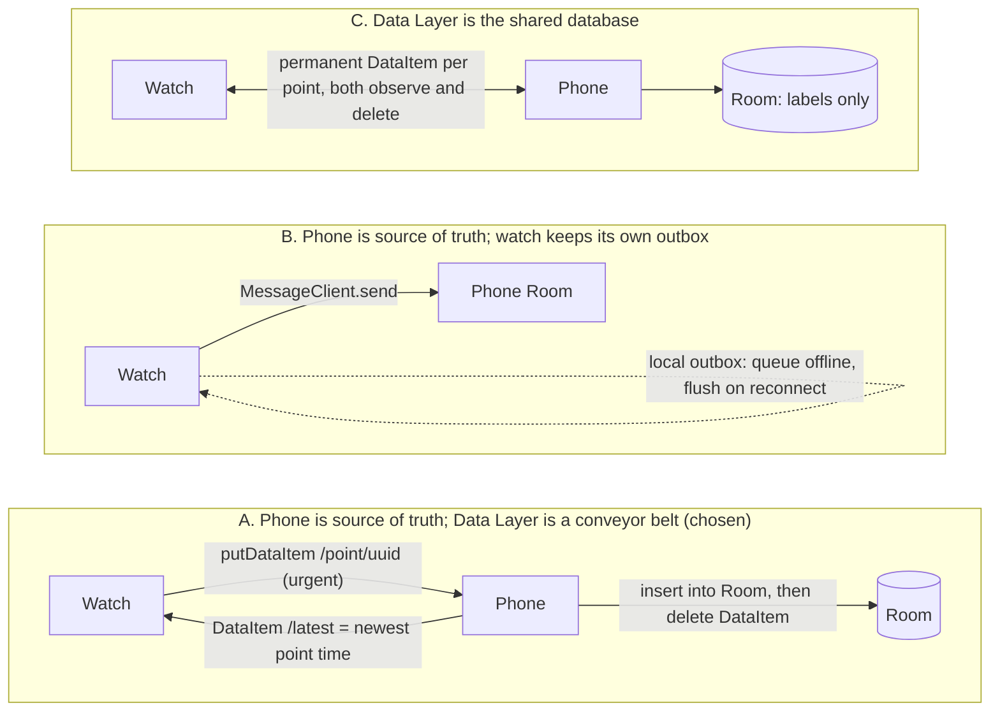
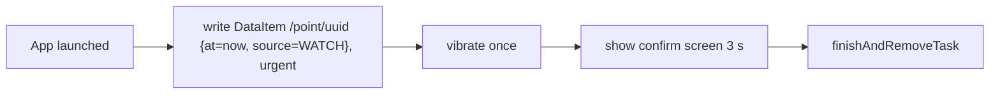

# Time Tracker MVP — Design

Date: 2026-10-25
Status: draft, awaiting owner approval

## 1. Intent

A personal time logger for a Samsung phone + Galaxy Watch. The single core
action is **"mark a point in time"**: press the watch's Home key twice (or the
phone's side key twice) and a timestamp is recorded. No category, no input, no
screen to look at. Later, on the phone, the owner labels the blocks of time
that lie between consecutive points.

Why: the owner used A Time Logger and found that having to pick a category
*at the moment of starting* interrupts whatever is happening. Capture must be
zero-decision; classification is deferred.

## 2. Goals, non-goals, anti-goals

**Goals**

- Marking a point costs one physical gesture and under one second of attention.
- Works when the watch is away from the phone; points are never lost.
- The owner can later make the record accurate: label, delete, move, and insert
  points on the phone.
- Data is exportable as a plain file.

**Non-goals (explicitly out of MVP)**

- Statistics, charts, summaries, goals, reminders.
- Cloud sync, accounts, backup beyond CSV export.
- Labeling on the watch.
- iOS, other watch platforms (Tizen), tablets.
- Multiple labels per block.

**Anti-goals (would make this a failure even if it worked)**

- Any choice or screen on the capture path. If marking a point ever requires
  reading or tapping, the product has failed.
- Silently dropping or merging points (e.g. auto-debouncing short blocks).
  Every press is recorded; cleanup is the owner's explicit act on the phone.

## 3. Constraints

- The owner's watch is a Galaxy Watch6-or-later (Wear OS 4+, One UI Watch 5+). Physical-key double-press is
  a system shortcut the owner binds to an app in the watch's Settings; the OS
  then *launches the app*. There is no API to intercept the key without
  launching. Therefore: **every launch of the watch app records a point**.
- Same shape on the phone: Samsung's side-key double-press setting launches an
  app (it replaces the default "open camera"). See §6.2 for the open question
  about distinguishing a side-key launch from a launcher-icon launch.
- The watch must never run a long-lived service for this; it launches, writes,
  shows one screen for ~3 s, exits.
- Phone is the only place with history, labels and editing. The watch stores
  exactly one value (timestamp of the latest known point) for its confirm screen.

## 4. Approaches considered (watch ↔ phone data flow)



- **A (chosen).** DataItems give offline queuing, reconnection and
  deduplication for free, so the watch has zero queue code. The phone consumes
  each item into Room and deletes it, so the Data Layer holds only in-flight
  points and never grows. The watch's "previous block N min" relies on `/latest`
  written back by the phone; it may be stale while the watch is offline, which
  is acceptable for a confirmation hint.
- **B.** MessageClient is fire-and-forget and fails outright when the phone is
  not connected, so the watch needs a hand-written outbox with retry and
  de-dup. That is the most bug-prone code in the system, bought for a latency
  gain of a few seconds at most. Rejected.
- **C.** The Data Layer is not a database: no queries, 100 KB per item,
  sync slows after thousands of items, and deletion propagation has edge cases.
  Labels live only on the phone anyway, so sharing the full point set buys
  nothing. Rejected.

## 5. Data model

Everything on the phone lives in one Room database. The watch has no database.

```text
Point
  id          UUID (string)          generated on the device that created it
  at          epoch millis (UTC)     the instant marked
  source      enum WATCH | PHONE | MANUAL
  tagId       nullable FK → Tag      label of the BLOCK THAT STARTS at this point
  note        nullable string        free-text note for that block
  createdAt   epoch millis           when the row was inserted

Tag
  id          UUID
  name        string, unique
  color       int (ARGB)             auto-assigned from a fixed palette on creation
  lastUsedAt  epoch millis           drives chip order in the label sheet
```

**Blocks are derived, not stored.** Sort points by `at`; block *i* runs from
point *i* to point *i+1*. The last point opens the "current block" that runs
to now. A block's label and note are those of its **start point**. This makes
every edit a plain row operation:

| Edit | Row operation | Effect on labels |
|------|---------------|------------------|
| Mark a point | insert | new block is unlabeled |
| Label a block | update `tagId` on its start point | — |
| Delete a point | delete row | the two neighbours merge; the earlier point's label survives |
| Move a point | update `at` | label travels with the point; constrained to stay strictly between its neighbours |
| Insert a point inside a block | insert with `at` chosen by owner | the new point is unlabeled; the first half keeps the old label. Same rule as a late-arriving watch point, so there is one insert path |

Idempotency: insert ignores a duplicate `id`. The watch may deliver the same
DataItem twice; the second is a no-op.

Ordering: sort by `(at, createdAt, id)`. Two points with the same `at` form a
zero-length block, shown as `0s`; the move constraint is "not before the
previous point and not after the next" (non-strict), so ties stay legal.

Clocks: `at` is the creating device's wall clock at launch. Both devices sync
time from the network; skew is at most a second or two and is not corrected.
A watch point that arrives late (after being offline) keeps its original `at`
and may split an already-labeled block; it follows the insert rule above.

A day in the UI is local midnight-to-midnight. A block that spans midnight
appears in both days, visually clipped, with its full label. No special
storage for this.

## 6. Behaviour

### 6.1 Watch

Entry points, both chosen by the owner:

1. **Home key double-press** (primary). Owner binds it to this app in watch
   Settings → Advanced features → Customize keys. Blind-operable.
2. **Complication** (fallback). A watch-face complication that launches the
   app on tap. Its text shows minutes since the latest known point
   (`/latest`), so the face itself gives the owner a glance at the current
   block length. Low cost on Wear OS; included.

Which launches count: the activity is `singleTop`; a point is written in
`onCreate` only when `savedInstanceState == null`, and in `onNewIntent` (a
second double-press while the confirm screen is still up is a real press and
is recorded). Recreation by the system (process restart, configuration
change) writes nothing.

Launch sequence (identical for both entries):



Confirm screen (non-interactive):

```text
      ┌─────────────┐
      │    14:32    │   time just marked
      │  ● 已记录   │   "recorded"
      │ 上一块 47 分钟│   "previous block 47 min" = now − latestKnownPointAt
      └─────────────┘
```

`latestKnownPointAt` = the most recent write of either the watch's own
successful mark or `/latest` from the phone (each overwrites; the phone is
authoritative, so deleting an accidental press stops the watch counting from
it), kept in a single DataStore preference. If no previous point is known, omit the third line.

Nothing else exists on the watch. No list, no labels, no settings.

### 6.2 Phone

**Capture entry:** side-key double-press, bound in Samsung Settings →
Advanced features → Side button → Double press → Open app. Same sequence as the
watch: write to Room directly, vibrate, show the same three-line confirm
overlay for ~2 s, then finish. The capture activity sets `showWhenLocked` and
`turnScreenOn` so it works from a locked phone in a pocket, exactly like the
camera shortcut it replaces; the same `singleTop` / `savedInstanceState` rule
as the watch decides which launches count. Verify on a locked device.

**Open question for the builder (resolve with a 10-minute spike before
building the phone UI):** does Samsung's side-button app picker list
`activity-alias` entries separately? If **yes**: ship two launcher aliases,
"Time Tracker" (opens the timeline) and "Mark" (records and finishes), and
bind the side button to "Mark". If **no**: the side button opens the timeline,
whose large "● 落点" button sits at the bottom at thumb reach, costing one
extra tap. The owner accepts the fallback; the alias path is preferred.

**Timeline screen** (default screen; mockup in
`.superpowers/brainstorm/*/content/screens.html`):

```text
 今天 · 10月25日                    ‹ ›
 ─────────────────────────────────────
 07:10   [早餐]                   35m
 07:45   [通勤]                   50m
 08:35   [工作]                3h 10m
 11:45   [未标]                0m 12s   ← accidental press, delete it
 11:45   [午饭]                   1h
 12:45   [未标]                1h 47m
 14:32   [未标]        进行中 · 12m   ← current block, live
 ─────────────────────────────────────
 [            ● 落点             ]
```

- One row per block: start time, tag chip (or dashed "未标"), duration.
- The last row is always the current block and ticks live.
- `‹ ›` steps one day; today is the landing page.
- Tap a row → label sheet. Long-press a row → delete its start point (with a
  confirmation snackbar offering undo for a few seconds — undo here is cheap
  because it is just re-inserting the row).
- Empty state (no points yet): a one-line hint to press the button or bind
  the side key.

**Label sheet** (bottom sheet over the timeline):

```text
 12:45 → 14:32
 1h 47m · tap 12:45 or 14:32 to change the time
 [工作] [通勤] [早餐] [午饭] [睡觉] [摸鱼] [+ 新标签]
 [ 在中间插一个点 ]   [ 删掉开始点 ]
 note: ______________________________ (optional, single line)
```

- Tapping a tag applies it immediately and closes the sheet. No confirm button.
- Chips ordered by `lastUsedAt` descending. "+ 新标签" asks for a name and
  applies the new tag at once.
- Tapping a boundary time opens the system time picker, limited to strictly
  between the neighbouring points; the end time edits the *next* point.
- "Insert a point" inserts at the block's midpoint and immediately opens the
  time picker on it.
- Note is saved on focus loss or sheet close.

**Tags settings screen:** list of tags; rename; delete (deleting a tag sets
`tagId = null` on its points after a confirmation stating the count).

**Export:** Settings → "Export CSV" uses the system file-create dialog
(Storage Access Framework). One row per block, including the current block
with `end` empty:

```csv
start_iso,end_iso,duration_sec,tag,note,source
2026-10-25T07:10:00+08:00,2026-10-25T07:45:00+08:00,2100,早餐,,WATCH
```

**Sync receiver:** a `WearableListenerService` (runs without the app open).
On each `/point/*` DataItem: insert into Room (idempotent), delete the
DataItem only if the insert succeeded (a failed insert leaves the item in
place; the Data Layer does not redeliver it, so leftover `/point/*` items are
consumed by a sweep whenever the phone app comes to the foreground), then write `/latest` with the newest `at` in the
database. `/latest`
is also rewritten after any phone-side insert, delete, or move that changes
the newest point.

## 7. Technology (builder's defaults, chosen by the designer)

- Kotlin; Jetpack Compose on the phone; Compose for Wear OS on the watch.
- Room on the phone; a single DataStore preference on the watch.
- `play-services-wearable` Data Layer (`DataClient`, `WearableListenerService`).
- `minSdk`: phone 26; watch 33 (Wear OS 4, Galaxy Watch6 onward).
- One Gradle project with two modules: `phone/` and `wear/`, with the **same
  `applicationId` and the same signing key** (debug and release), which is what
  the Data Layer requires to pair them.
- Distribution: sideload with `adb` (phone over USB, watch over Wi-Fi ADB).
  No Play Store work in the MVP.
- UI language: English only, via `strings.xml` with a single default locale.
  The Chinese strings in the wireframes above are placeholders from the
  brainstorm mockup. A tiny `shared/` module
  for the Data Layer path constants and the point payload keys, nothing else.
- No DI framework, no navigation library beyond what Compose needs for two
  screens, no network.

## 8. Verification

- Unit tests on the pure functions: points → blocks derivation; merge on
  delete; insert-copies-label; move constraints; CSV line formatting;
  midnight-spanning block appears in both days.
- One instrumented test for the Room idempotent insert.
- Manual on-device checklist, since the key bindings cannot be automated:
  watch double-press with phone connected (point appears on phone within
  seconds); watch double-press in airplane mode, then reconnect (point
  arrives, no duplicate); phone side-key path; export opens and the file
  parses.

## 9. Left to the builder

- Exact Compose styling, palette values, animation of the confirm overlay.
- Complication type and update cadence (suggest SHORT_TEXT, refreshed by the
  system's periodic update plus on each `/latest` change).
- Undo snackbar duration.
- Whether `shared/` is a module or just a duplicated constants file (two
  constants do not justify a module; builder's call).
- The §6.2 side-button spike and which branch it lands on.

## 10. Decisions made by the designer, not the owner

Listed so the owner can object:

- Label lives on the block's **start point**; delete keeps the earlier label;
  insert copies the label into the new point.
- Every launch of the watch app is a point (there is no other watch UI).
- Confirm screen auto-dismisses after 3 s (watch) / 2 s (phone).
- Tag colours are auto-assigned, not chosen.
- Day boundary is local midnight; no "day starts at 4am" setting.
- Phone-side delete gets an undo snackbar; watch has no undo.
- CSV is per-block, not per-point.
- Inserted points (manual or late-arriving) never copy a label.
- Deleting the very first point in history drops its label and note; allowed.
- Tag names are unique case-insensitively; the tag-delete confirmation counts
  points carrying the tag.
- Times are rendered in the device's current zone; CSV uses the offset at
  export time. Zone is not stored per point.
- Phone capture shows over the lock screen.
